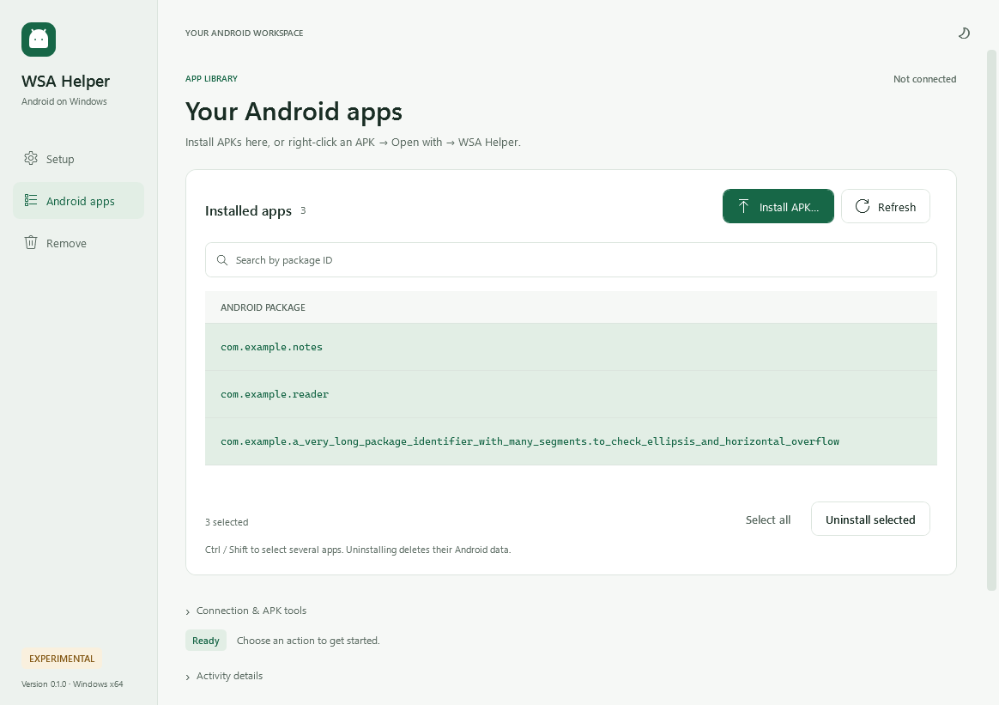
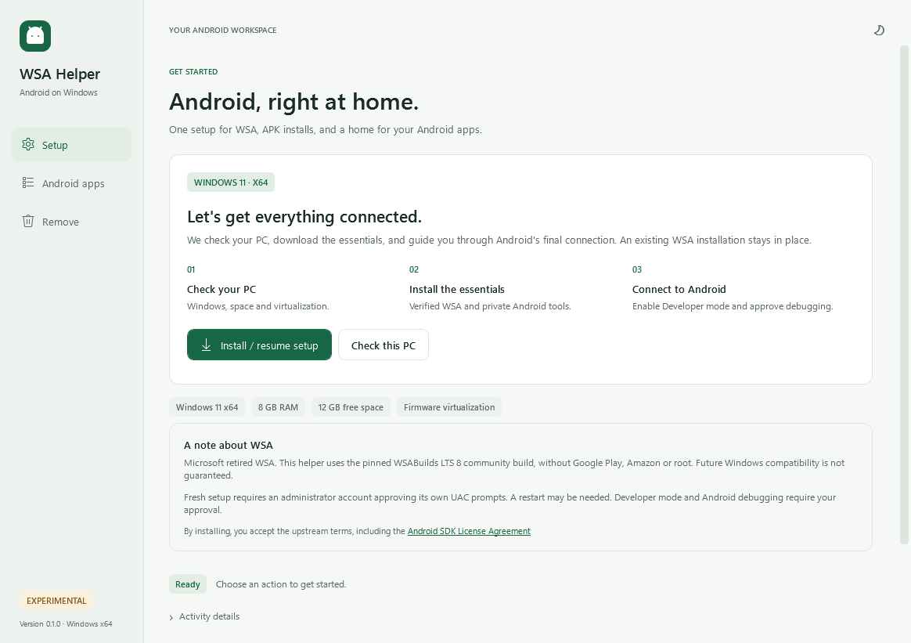
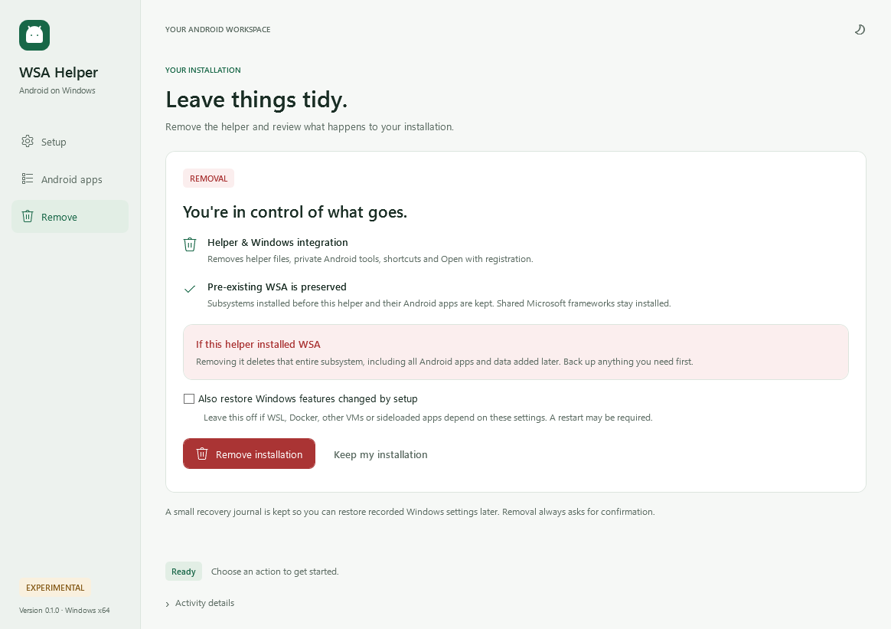

# WSA Helper

Maintained by [Hermann (HECer)](https://github.com/HECer). [Download the experimental v0.1.0 pre-release](https://github.com/HECer/Windows11AndroidSubsystemHelperApp/releases/tag/v0.1.0).

A native Windows 11 app for setting up Windows Subsystem for Android (WSA), installing APKs from Explorer, and managing Android apps. **Release candidate / experimental. Windows 11 x64 only.**

**Do not use this candidate for a fresh production WSA installation.** Existing-WSA helper setup/removal has been exercised. The elevated fresh-deployment path is implemented but still needs clean-machine verification. See [acceptance gates](docs/ACCEPTANCE.md).

Microsoft retired WSA and removed it from the Store on March 5, 2025 ([notice](https://github.com/microsoft/WSA/discussions/536)). This project uses an explicitly pinned [WSABuilds community build](https://github.com/MustardChef/WSABuilds/releases/tag/Windows_11_2407.40000.4.0_LTS_8). It does not restore Microsoft's support or guarantee compatibility with future Windows updates. It is unaffiliated with Microsoft, Google, Amazon, or WSABuilds.

## Screenshots

Rendered app previews in light and dark themes. The app-library rows use sample package IDs.

### Android apps

Search installed packages, select multiple apps, and install APKs from one place.

<picture>
  <source media="(prefers-color-scheme: dark)" srcset="docs/images/apps-selected-dark.png">
  
</picture>

<details>
<summary>Setup and removal screens</summary>

### Setup

<picture>
  <source media="(prefers-color-scheme: dark)" srcset="docs/images/setup-dark.png">
  
</picture>

### Remove

<picture>
  <source media="(prefers-color-scheme: dark)" srcset="docs/images/remove-dark.png">
  
</picture>

</details>

[Screenshot generation and provenance](docs/images/README.md)

## Use

1. Extract the entire release ZIP to a local folder. Run **WsaSetup.exe** normally, without “Run as administrator”. No separate .NET installation is needed in the published package.
2. Read the source and license information, then choose **Install / resume setup**. Setup checks Windows, RAM, storage and virtualization; requests UAC for Virtual Machine Platform, sideloading policy and WSA's system service; downloads and verifies WSA and Android platform-tools; and installs missing framework dependencies and WSA for your Windows account. A pre-existing WSA installation is reused.
3. If Windows needs a restart, save your work and restart yourself. Setup resumes through a one-time sign-in entry. You can also reopen Setup to resume or Remove to undo partial setup.
4. In **WSA settings → Advanced settings**, enable **Developer mode**. Start the subsystem using **Files** if necessary and approve **Allow debugging**. These Windows/Android security approvals cannot be bypassed. Firmware virtualization must be enabled in UEFI/BIOS if it is off; the app explains this rather than claiming it can change firmware.
5. **Right-click an APK → Open with → Choose another app → WSA Helper**. If Windows has not refreshed the app list, browse to `%LOCALAPPDATA%\WsaHelper\App\WsaHelper.exe`. The APK installs automatically, replacing a compatible existing version. Windows lets you choose whether to make this the default; the helper does not overwrite Windows' UserChoice.
6. Start **WsaHelper.exe** / **Android Apps** without a file to list user-installed apps. Use **Install APK…**, **Uninstall from APK…**, or select rows (Ctrl/Shift or Select all) and **Uninstall selected**. Uninstalls require confirmation because app data is deleted. Package IDs are displayed rather than potentially misleading inferred app names.

The manager starts WSA when needed and reconnects to `127.0.0.1:58526`. It waits up to two minutes for startup and Android's debugging approval, then continues the requested operation automatically. Cancel stops the wait; if it expires, approve debugging and use Refresh to retry. It never replaces or rotates ADB keys to bypass authorization. An alternative **loopback port** can be entered if your WSA settings show one. Remote IPs, emulators and USB devices are deliberately excluded. A private ADB server listens on loopback port 5039; an existing SDK's default ADB server is not stopped. Explorer launches while the manager is open are queued through a local per-user inbox and saved before acknowledgment. The app does not repeatedly open error dialogs while idle. Malformed requests are retained with a `.rejected` suffix. Failed APKs are reported individually; setup and pending work are recorded for recovery.

Only individual `.apk` files are supported. `.apks`, `.xapk`, split APK sets and Google Play services are not installed. Compatibility depends on WSA and the APK. No Google account or app store is required.

Setup, Android apps and Remove share a sidebar, an emerald accent and coordinated light/dark themes. The initial theme follows Windows; the top-right appearance button switches it for the current session. High-contrast mode uses Windows colors. The app library includes search, selection counts and separate disconnected, empty and no-results states. Connection tools and **Uninstall from APK…** are under **Connection & APK tools**. Progress, cancellation and errors stay in the window; expand **Activity details** for the full log. Destructive operations still ask for confirmation.

Fresh WSA setup and removal currently require an administrator account that approves its own UAC prompts. Supplying a different administrator's credentials is rejected before privileged changes; it would register WSA for the wrong account. Windows Administrator protection configurations that change the elevated account SID are also rejected. Existing WSA management runs without elevation. These account limitations must be considered before using this candidate.

## Remove / reverse setup

Run **WsaRemove.exe**, use the Remove tab, or select WSA Helper in Windows Installed apps.

- If this helper installed WSA, removal requests UAC, verifies the protected ownership journal, unregisters that exact WSA location and deletes its files. **All Android apps and Android data in that WSA installation are lost**, including apps installed later through other tools. Back up data first.
- A pre-existing WSA installation is preserved, as are shared Microsoft framework packages; they may be used by other apps.
- By default, Windows virtualization and sideloading settings remain enabled. The optional restore checkbox restores only settings recorded by this setup. Use it only if WSL, Docker, other VMs and other sideloaded apps do not now rely on them. Windows may require a restart. Restoration is an explicit user choice because the helper cannot determine all later consumers of a shared Windows feature.
- File associations, app registration, shortcuts and the helper's private platform-tools are removed. Close the removal window to finish deleting helper executables. A file manifest records exactly which helper files were installed and their SHA-256 hashes; cleanup preserves added files and modified files, refuses linked/escaping paths, and removes only empty directories. `%LOCALAPPDATA%\WsaHelper\cleanup-result.json` records any modified helper files retained for review.
- `%LOCALAPPDATA%\WsaHelper\state.json` remains as a small recovery journal. If machine settings were retained, run Remove again from the downloaded release to restore them later. A protected machine journal lives under `HKLM\SOFTWARE\WsaHelper\Changes\<installation-id>` until those settings are restored. No credentials are stored.

Interruptions do not silently trigger destructive rollback: finished changes remain journaled so that retry or removal is deliberate. Cancellation waits for an in-progress DISM feature change to finish.

## Requirements and downloads

Windows 11 x64 (build 22000+), at least 8 GB RAM (16 GB recommended), 12 GB free space, CPU virtualization enabled in firmware, administrator approval for machine settings, and internet access to GitHub and Google's Android download server. No Windows Home Hyper-V hack or execution-policy change is required. SSD storage is recommended. Windows on ARM and Windows 10 are outside this release's scope.

The WSA runtime is staged under `%ProgramFiles%\WsaHelper\Subsystems\<installation-id>\Runtime`, with a protected machine ownership journal beside it. Only Administrators and SYSTEM can modify the tree; users and application containers receive read/execute access. The elevated worker copies the download into that protected tree and checks the pinned hash again before extraction or registration. It refuses another account's WSA installation and linked or untrusted runtime paths. Fresh staging requires 12 GB free on the Program Files drive as well as the profile-drive space checked by Setup.

`src/WsaHelper.Core/catalog.json` pins exact URLs, sizes and SHA-256 digests:

- WSA 2407.40000.4.0, WSABuilds LTS 8, **NoGApps-NoAmazon, no root** (554 MB compressed).
- Google Android platform-tools 37.0.2 for Windows (8.2 MB compressed).

WSA and Google's binaries are downloaded on the user's computer; they are not redistributed in this project's release ZIP. Downloads fail closed on a size/hash mismatch. A matching digest establishes the identity of the pinned artifact, not an independent security endorsement of the community build. Archives are extracted with path, link and expansion checks; upstream installer scripts are never executed. Windows AppX deployment validates framework package signatures and trust. WSA is a community-modified, loosely registered package and is not described as Microsoft-signed.

See [third-party terms](THIRD-PARTY-NOTICES.md). By choosing Install, users agree to the applicable upstream terms, including the [Android SDK License Agreement](https://developer.android.com/studio/terms). No telemetry, analytics or credentials are collected by this helper. WSA and Android components have their own behavior and terms. Logs in the window can contain local file paths and package IDs; review them before sharing.

## Build and test

Install the .NET 10 SDK on Windows:

```powershell
dotnet test tests/WsaHelper.Tests/WsaHelper.Tests.csproj -c Release
dotnet build src/WsaHelper.Desktop/WsaHelper.Desktop.csproj -c Release
./scripts/Publish.ps1 -Version 0.1.0
```

The publish script tests, builds a self-contained x64 package with three entry points, and writes a ZIP and SHA-256 sidecar under `artifacts/release`. No global SDK, ADB, or subsystem installation is performed by build/tests. CI builds/tests on Windows; a manually dispatched packaging workflow produces downloadable GitHub Actions artifacts. GitHub Releases are the distribution mechanism for this Windows ZIP; GitHub Packages does not provide a generic Windows-app package registry.

Optional downloaded-artifact integration test: place the pinned archives at `<folder>\wsa.7z` and `<folder>\platform-tools.zip`, set `WSA_HELPER_VALIDATION_ARCHIVES` to that folder, and run `dotnet test ... --filter Category=DownloadIntegration`. It verifies hashes, extracts real archives, checks the WSA manifest and dependency files, and runs the real ADB binary on its private server port. It never installs WSA or changes Windows features.

Optional existing-WSA test: with Android SDK build-tools 36.0.0, Android platform 33 and Java installed, run `./scripts/New-SmokeApks.ps1 -OutputDirectory <new-temporary-folder>`. Set `WSA_HELPER_LIVE_FIXTURES` to the resulting `fixtures.json`, enable WSA Developer mode, start WSA and approve debugging, then run `dotnet test tests/WsaHelper.Tests/WsaHelper.Tests.csproj -c Release --filter Category=ExistingWsaIntegration`. The test uses uniquely named, code-free signed fixtures; refuses Windows feature/AppX changes; checks real install/update/list/single and bulk uninstall; verifies the original installed-app list; and tests preservation of the existing subsystem on helper removal. It cleans up only its disposable packages. An optional `WSA_HELPER_LIVE_ENDPOINT` can select a different loopback port. These tests are skipped unless explicitly enabled; ordinary CI does not touch a host's WSA or Android apps.

If WSA shows Developer mode enabled but the endpoint refuses connections, check that its Files button actually opens the Android file manager. Refresh Developer mode and retry. Restarting WSA may help, but closes open Android apps; save their work first. A registered WSA package and a running VM do not prove that Android or its debugger is ready. The helper does not replace an existing subsystem to work around a failed debugger.

Before a public production release, complete the [clean-machine acceptance checklist](docs/ACCEPTANCE.md). Local build and automated tests cannot establish actual WSA boot, UAC/reboot behavior, firmware support, APK compatibility, or end-to-end removal on every Windows edition. Release executables are unsigned unless a maintainer adds signing; Windows SmartScreen can show an unknown-publisher warning.
